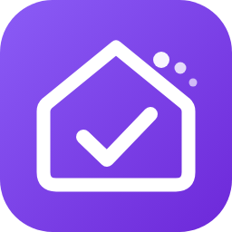

  

<h1 align="center">Yuvomi für Home Assistant</h1>

  <em>Inoffizielle Community-Integration – nicht Teil des Yuvomi-Projekts. 
  <a href="README.md">English</a></em>

  
  
  

Bindet den selbst gehosteten Familienplaner [Yuvomi](https://github.com/ulsklyc/yuvomi) an Home Assistant an. Yuvomi bleibt der Master: Was Home Assistant anlegt, ändert oder löscht, landet sofort in Yuvomi, und Änderungen in Yuvomi kommen in Home Assistant als Zustände und Ereignisse an.

Die Integration spricht **ausschließlich über die öffentliche REST-API (`/api/v1`)** mit einem API-Token und den unten genannten Scopes – die Schnittstelle, die der Yuvomi-Entwickler stabil zusagt. Jeder genutzte Endpunkt steht in Yuvomis OpenAPI-Spezifikation; interne Endpunkte, Datenbank oder Dateien werden nie angefasst. Fragen zu dieser Integration bitte hier im Repository stellen, nicht beim Yuvomi-Projekt.

**Inhalt:** [Auf einen Blick](#auf-einen-blick) · [Voraussetzungen](#voraussetzungen) · [Installation](#installation) · [API-Token und Scopes](#api-token-und-scopes) · [Module und Entitäten](#module-und-entitäten) · [Optionen](#optionen) · [Aktuell halten](#aktuell-halten) · [Bring-Abgleich (optional)](#bring-abgleich-optional) · [Dienste](#dienste) · [Ereignisse](#ereignisse) · [Sprachassistent (Assist)](#sprachassistent-assist) · [Blueprints](#blueprints) · [Fehlersuche](#fehlersuche) · [Diagnose](#diagnose) · [Entfernen](#entfernen) · [Bekannte Grenzen](#bekannte-grenzen) · [Pflege](#pflege) · [Lizenz](#lizenz)

## Auf einen Blick

- ✅ **Aufgaben, Einkaufslisten, Vorrat** als To-do-Listen in Home Assistant – anlegen, bearbeiten, abhaken, löschen
- 📅 **Kalender** für Familientermine, Essensplan und Geburtstage
- 🧹 **Putzplan** mit „Erledigt“-Knopf je Aufgabe
- 🛒 **Bring-Abgleich** – Yuvomi-Einkaufsliste und Bring in beide Richtungen gleich halten
- ⚡ **Nahezu sofortige Aktualisierung** über einen Yuvomi-Benachrichtigungskanal (Webhook)
- 🔔 **Ereignisse** für eigene Automationen, z. B. Benachrichtigungen aufs richtige Handy

## Voraussetzungen

- Yuvomi **ab 2.79**, **empfohlen ab 2.84**: Ab 2.84 meldet Yuvomi seine Schnittstellen-Generation (`client_api` in `/api/v1/version`). Die Integration prüft sie beim Einrichten und bei jedem Start. Ältere Versionen laufen, zeigen aber einen Hinweis unter Reparaturen.
- Home Assistant ab 2025.1.

## Installation

**Marketplace (ab Home Assistant 2026.11):** Einstellungen → Marketplace → nach **Yuvomi** suchen → *Yuvomi (Community)* installieren → Home Assistant neu starten. Solange die Integration noch nicht im Standardkatalog steht, stattdessen als benutzerdefiniertes Repository hinzufügen: Einstellungen → Marketplace → Repository per Link hinzufügen (englisch *Add from link*) → `https://github.com/Thomas-1904/ha-yuvomi` → *Yuvomi (Community)* installieren → Home Assistant neu starten. Für das Hinzufügen per Link muss im Marketplace ein GitHub-Konto verbunden sein (nur Lesezugriff, wird auch für die Update-Prüfung alle 48 h genutzt). Eine Installation aus HACS wird beim Home-Assistant-Update automatisch übernommen.

**HACS (bis Home Assistant 2026.10):** HACS → nach **Yuvomi** suchen → installieren → Home Assistant neu starten. Solange sie noch nicht gelistet ist: HACS → ⋮ → Benutzerdefinierte Repositories → `https://github.com/Thomas-1904/ha-yuvomi` hinzufügen (Typ *Integration*) → *Yuvomi (Community)* installieren → Home Assistant neu starten.

**Manuell:** `yuvomi.zip` aus dem neuesten [Release](https://github.com/Thomas-1904/ha-yuvomi/releases) laden, nach `/config/custom_components/yuvomi` entpacken, Home Assistant neu starten.

Danach: Einstellungen → Geräte & Dienste → Integration hinzufügen → **Yuvomi (Community)**, URL (z. B. `http://192.168.1.10:3005`) und API-Token eingeben, Module auswählen. Ändert sich das Token später, fragt Home Assistant nach dem neuen (erneute Anmeldung). URL (oder Token) selbst ändern: Einstellungen → Geräte & Dienste → Yuvomi → ⋮ → *Neu konfigurieren*. Die Einrichtung bleibt in beiden Fällen erhalten.

## API-Token und Scopes

Token in Yuvomi unter *Einstellungen → API-Tokens* anlegen. Nur die Scopes für die gewünschten Module vergeben (`write` schließt `read` ein). Module ohne Berechtigung bleiben einfach leer.

| Modul der Integration | Scope | Hinweis |
|---|---|---|
| Immer (Mitglieder, Übersicht) | `family:read`, `dashboard:read` | |
| Aufgaben | `tasks:write` | `tasks:read` nur zum Anzeigen |
| Einkaufslisten | `shopping:write` | auch für den Bring-Abgleich |
| Familienkalender, Erinnerungen, Geburtstage | `calendar:write` | Yuvomi fasst alle drei unter `calendar` zusammen |
| Essensplan, Rezepte | `meals:write` | |
| Vorrat | `pantry:write` | |
| Inventar & Wartung | `inventory:write` | |
| Putzplan & Haushaltshilfe | `housekeeping:write` | |
| Müllabfuhr | `waste:read` | |
| Budget, Konten, Abos, Kredite, geteilte Ausgaben | `budget:write` | |
| Belohnungen & Taschengeld | `rewards:write` | |
| Notizen / Kontakte / Dokumente / Schichtplan / Gesundheit | `notes` / `contacts` / `documents` / `schedule` / `health` | `:read` oder `:write` |
| Sofort-Aktualisierung – optional automatische Kanaleinrichtung | Token eines **Administrators ohne Scopes** | nicht empfohlen: Ein solches Token hat vollen Zugriff auf alle Familiendaten und liegt dauerhaft in Home Assistant. Empfohlen: beim eingeschränkten Token bleiben und den Kanal einmal von Hand anlegen (siehe unten) |

## Module und Entitäten

Mit echten Daten getestet: Aufgaben, Einkaufslisten, Vorrat, Familienkalender, Essensplan, Rezepte, Putzplan, Geburtstage, Erinnerungen. Inventar: Schnittstellen geprüft, bisher aber nur mit leerem Inventar.

**Experimentell** (nach der OpenAPI-Beschreibung gebaut, noch nicht mit echten Daten gelaufen – Rückmeldungen willkommen): Müllabfuhr, Budget/Konten/Abos, Kredite, geteilte Ausgaben, Belohnungen, Notizen, Kontakte, Dokumente, Schichtplan, Gesundheit. In der Modulauswahl als *(experimentell)* gekennzeichnet und standardmäßig aus.

| Modul | Entitäten |
|---|---|
| Aufgaben | To-do-Liste (anlegen, bearbeiten, abhaken mit „erledigt von“, Fälligkeit mit Uhrzeit, Beschreibung, Wiederholung; Mitglieder, Zuweisung, Priorität, Punkte als Attribute), zusätzlich je Mitglied eine eigene To-do-Liste („Aufgaben Sam“: nur deren Aufgaben; neue Einträge werden zugewiesen), Sensoren offen / überfällig / heute erledigt / diese Woche / 30 Tage / Serie / wiederkehrende Aufgaben, ein Sensor je Mitglied, *Rangliste* (Wochensieger; Woche/Monat mit Punkten und Aufgaben als Attribute) und *Punkte Woche* je Mitglied – aus Yuvomis Punktekonto, falls genutzt, sonst aus den Punkten erledigter Aufgaben, Binärsensor überfällig |
| Einkaufslisten | Je Yuvomi-Liste eine To-do-Liste („Milch (2 l)“ setzt die Menge; nach Kategorien in Yuvomis Reihenfolge sortiert; neue Artikel bekommen automatisch eine Kategorie – aus dem eigenen Verlauf in Yuvomi oder einer Liste gängiger Artikel), Sensor offene Artikel |
| Familienkalender | Kalender (lesen, anlegen, bearbeiten, löschen inkl. Serien; wiederkehrende Termine werden in Yuvomi bearbeitet), Sensor anstehende Termine |
| Essensplan | Kalender (Mahlzeitart in der Beschreibung; neue Einträge legen Essen an – die Uhrzeit bestimmt die Mahlzeit, Beschreibung = Notiz), Knopf *Zutaten der Woche auf die Einkaufsliste* (nächste 7 Tage, auf die Bring-Liste falls eingerichtet, sonst die erste Liste), Sensor „Essen heute“ (Woche als Attribut) |
| Rezepte | Sensor mit allen Rezepten |
| Vorrat | To-do-Liste (Fälligkeit = MHD, abhaken = aufgebraucht), Sensoren Artikel / knapp / läuft ab, Binärsensor abgelaufen |
| Inventar & Wartung | Sensor Inventar, Sensor je Gegenstand mit nächster Wartung, Knopf „Erledigt“, Kalender „Fristen & Wartung“ |
| Putzplan & Haushaltshilfe | To-do-Liste *Putzplan* (fällige Aufgaben offen, abhaken = erledigt; neuer Eintrag mit Beschreibung `Bereich · 7` setzt Bereich und Intervall in Tagen), Sensor fällige Putzaufgaben (alle Aufgaben mit Bereich, Intervall, zuletzt erledigt, Status als Attribute), Knopf „Erledigt“ je Aufgabe, Binärsensor Haushaltshilfe da |
| Geburtstage | Kalender (neue Einträge legen Geburtstage an; „Anna (1990)“ setzt das Geburtsjahr), Sensor nächster Geburtstag |
| Erinnerungen | Sensor fällige Erinnerungen, Binärsensor Erinnerung fällig |
| Müll *(exp.)* | Kalender, Sensoren nächste Abholung, Binärsensoren heute/morgen |
| Budget, Kredite, geteilte Ausgaben *(exp.)* | Ausgaben/Saldo Monat, Sensoren je Konto und Abo, Knopf „Abo verlängern“, Restschuld, Saldo geteilte Ausgaben |
| Belohnungen, Notizen, Kontakte, Dokumente, Schichten, Gesundheit *(exp.)* | Offene Einlösungen, angeheftete Notizen, Kontakte, ablaufende Dokumente, Kalender Schichtplan und Schichten heute, Medikamente, Vorsorge fällig, Gewicht, Blutdruck, Kalorien heute |
| Immer | Update-Entität *Server* (zeigt, wenn eine neuere Yuvomi-Version verfügbar ist, siehe Optionen), Ereignis-Entität *Benachrichtigung* (ein Ereignis je Yuvomi-Benachrichtigung, im Automationseditor nutzbar), Knopf „Neu laden“; Diagnosesensor „Bring-Abgleich“ (wenn eingerichtet) |

„Erledigt von“: Wird eine Aufgabe in Home Assistant abgehakt, sucht die Integration das Yuvomi-Mitglied, dessen Name zum angemeldeten Home-Assistant-Benutzer passt (voller Name oder Vorname).

## Optionen

Einstellungen → Geräte & Dienste → Yuvomi → *Konfigurieren*:

- **Module**, die geladen werden (abgewählte Module entfernen ihre Entitäten).
- **Änderungsereignisse auslösen** (`yuvomi_changed`, standardmäßig an).
- **Abfrageintervall** in Sekunden (Standard 60, 15–3600).
- **Sofort-Aktualisierung**: Benachrichtigungskanal in Yuvomi automatisch anlegen. Bequem, braucht aber ein Admin-Token ohne Scopes (voller Zugriff auf alle Familiendaten) – empfohlen ist die Einrichtung von Hand (siehe unten).
- **Nach neuen Yuvomi-Versionen suchen** (standardmäßig an): fragt alle 6 Stunden die öffentliche GitHub-Schnittstelle nach der neuesten Yuvomi-Version und zeigt ein Update unter Einstellungen → Updates. Über deine Instanz wird dabei nichts übertragen.
- **Bring-Liste** und **Yuvomi-Einkaufsliste** für den Bring-Abgleich (leer = aus).

## Aktuell halten

- **Abfrage** aller aktiven Module im eingestellten Intervall.
- **Änderungszähler:** Alle 15 s liest die Integration `/api/v1/shopping/versions` (eine sehr kleine Anfrage) und aktualisiert sofort, wenn sich eine Liste geändert hat.
- **Benachrichtigungskanal (empfohlen):** Yuvomi meldet seine Benachrichtigungen an einen Home-Assistant-Webhook; jede kommt als Ereignis `yuvomi_webhook` an und löst eine sofortige Aktualisierung aus. Kommen die Webhooks zuverlässig an, kann das Abfrageintervall großzügiger sein.
  - *Von Hand (empfohlen):* Einstellungen → Geräte & Dienste → Yuvomi → *Konfigurieren* öffnen. Der Dialog zeigt die Webhook-Adresse. In Yuvomi als Administrator einen Benachrichtigungskanal vom Typ *Webhook* mit dieser Adresse anlegen. Die Integration läuft dabei weiter mit eingeschränktem Token. Die Adresse wie ein Passwort behandeln – sie erscheint nur für Administratoren in diesem Dialog, nie in einer Entität. Ist sie doch einmal nach außen gelangt, dort *Neue Webhook-Adresse erzeugen* anhaken und die neue Adresse in Yuvomi eintragen.
  - *Automatisch (bequemere Alternative):* Die Option *Sofort-Aktualisierung* legt einen Kanal vom Typ *Webhook* namens „Home Assistant“ an. Dafür braucht es ein Administrator-Token ohne Scopes, das vollen Zugriff auf alle Familiendaten hat und dauerhaft in Home Assistant liegt.
  - Yuvomi lehnt Adressen im Heimnetz ab, solange beim Yuvomi-Container nicht `NOTIFICATION_ALLOW_PRIVATE_NETWORK=true` gesetzt ist. Ohne diese Einstellung nimmt die Integration die externe Home-Assistant-Adresse (z. B. Nabu Casa), falls eine eingerichtet ist – die Benachrichtigungstexte laufen dann über diese externe Adresse.
  - Der Kanal transportiert *Benachrichtigungen* (Erinnerungen, fällige Aufgaben …), nicht jede Datenänderung. Die regelmäßige Abfrage bleibt die Absicherung.
- **Ratenlimit:** Yuvomi erlaubt 300 Anfragen pro Minute **je IP-Adresse**. Hinter NAT oder Reverse Proxy teilt sich Home Assistant dieses Kontingent womöglich mit den Handys der Familie. Die Integration begrenzt sich deshalb selbst auf 120 Anfragen pro Minute und pausiert automatisch, wenn Yuvomi mit `429` antwortet. Ein vollständiger Abruf aller Standardmodule braucht rund ein Dutzend Anfragen.

## Bring-Abgleich (optional)

In den Optionen lässt sich eine beliebige To-do-Liste aus Home Assistant (z. B. eine Bring-Liste aus der Bring-Integration) wählen, die in beide Richtungen mit einer Yuvomi-Einkaufsliste gleich gehalten wird: neue Artikel, abgehakt/wieder offen, gelöscht und Menge (Yuvomi-Menge ↔ Bring-Spezifikation). Abgeglichen wird über den Artikelnamen; ein gespeicherter Stand des letzten Abgleichs entscheidet, welche Seite sich geändert hat. Einträge, die nur unter Bring „Zuletzt verwendet“ stehen, werden nicht übernommen und bleiben dort, wenn Yuvomi Erledigte aufräumt. Der Abgleich läuft bei jeder Änderung auf einer der Seiten und alle 5 Minuten; `yuvomi.sync_bring` gleicht sofort ab, der Diagnosesensor „Bring-Abgleich“ zeigt das letzte Ergebnis.

## Dienste

- **Generisch** für jede Ressource der API: `yuvomi.create`, `yuvomi.get`, `yuvomi.update` (führt mit dem aktuellen Stand zusammen), `yuvomi.delete`. Unterobjekte brauchen eine `parent_id` (z. B. die Liste bei `shopping_item`).
- **Aufgaben & Haushalt:** `add_task`, `complete_task`, `complete_housekeeping`, `housekeeper_check`, `complete_inventory_date`, `dismiss_reminder`.
- **Einkauf & Essen:** `add_shopping_item`, `clear_checked`, `sort_shopping` (Artikeln ohne Kategorie eine geben), `add_meal`, `meals_to_shopping`, `pantry_to_shopping`, `shopping_to_pantry`, `sync_bring`.
- **Experimentelle Module:** `add_budget_entry`, `renew_subscription`, `loan_payment`, `reward_bonus`, `redeem_reward`, `pin_note`, `check_note_item`, `add_vital`, `medication_dose`, `add_nutrition`.
- `yuvomi.refresh` erzwingt einen Abruf.
- `yuvomi.api_request` ruft beliebige `/api/v1/…`-Pfade direkt auf. **Das ist ein Notausgang:** Verbindlich ist nur, was in Yuvomis OpenAPI-Spezifikation steht – alles darüber hinaus kann mit jedem Yuvomi-Update brechen.

## Ereignisse

- `yuvomi_changed` bei jedem neuen, geänderten oder gelöschten Objekt: `resource`, `action` (`created`/`updated`/`deleted`), `id`, `title`, `item`, `changed`, `old_status`.
- `yuvomi_webhook` für eingehende Benachrichtigungen: `data.notification` mit `title`, `body`, `url`, `tag`, `priority`. Der Payload nennt keinen Empfänger – Benachrichtigungen an einzelne Handys zu verteilen, geht über die Blueprint unten oder eine eigene Automation.
- Die Ereignis-Entität *Benachrichtigung* löst dieselben Benachrichtigungen als Ereignistyp `notification` aus, mit `title`, `body`, `url`, `tag`, `priority`, `task_id` (aus Tag/URL gelesen) und `sent_at`.

## Sprachassistent (Assist)

Die Entitäten funktionieren mit dem Sprachassistenten von Home Assistant, sobald sie freigegeben sind (Einstellungen → Sprachassistenten → Freigeben):

- **Eingebaute Sätze:** „Setz Milch auf die Einkaufsliste“ und ähnliche Befehle zum Hinzufügen funktionieren mit allen Einkaufs- und Aufgabenlisten.
- **Mit einem KI-Gesprächsagenten** (z. B. OpenAI, Google, Anthropic, Ollama) auch freie Fragen wie „Was gibt es heute zu essen?“ (Essensplan-Kalender), „Welche Putzaufgaben sind fällig?“ (Putzplan-Liste), „Was muss Sam heute erledigen?“ (Aufgabenliste je Person) oder „Wann hat Anna Geburtstag?“ (Geburtstagskalender).
- Tipp: Den Listen in den Entitätseinstellungen eindeutige Aliase geben (z. B. „Einkaufsliste“), damit Assist sie findet.

## Blueprints

| Blueprint | Importieren |
|---|---|
| Benachrichtigungen an die zugewiesene Person – Aufgaben-Benachrichtigungen nur an die zugewiesenen Personen (mit Knöpfen „Erledigt“ / „Morgen“), alles andere an alle |  |
| Gerät fertig → Aufgabe – z. B. „Waschmaschine ausräumen“, keine Doppelten, solange eine offen ist |  |

Die Blueprints sind englisch beschriftet.

## Fehlersuche

- **Ein Modul bleibt leer:** Dem Token fehlt der Scope des Moduls (siehe Tabelle) oder das Modul ist in Yuvomi nicht aktiv. Ein Hinweis unter Einstellungen → Reparaturen nennt die betroffenen Module und die nötigen Scopes.
- **Einrichtung scheitert mit „fehlender Scope“:** Das Token braucht mindestens `family:read`.
- **Reparatur-Hinweis „Update empfohlen“ / „zu alt“:** Yuvomi aktualisieren; der Hinweis verschwindet beim nächsten Start.
- **Keine Sofort-Aktualisierung:** Im Log nach „Yuvomi-Push nicht eingerichtet“ suchen (Kanal konnte nicht angelegt werden – Token ohne Admin-Rechte oder keine erreichbare Adresse) und den Kanalstatus in Yuvomi prüfen.
- **Meldungen zum Ratenlimit:** Abfrageintervall erhöhen; andere Geräte hinter derselben IP zählen bei Yuvomi mit.

## Diagnose

Einstellungen → Geräte & Dienste → Yuvomi → ⋮ → *Diagnose herunterladen*. Die Datei enthält die Einrichtung, die Yuvomi-Version, welche Module antworten, und je Datenart nur die Anzahl der Einträge und ihre Feldnamen – keine Familiendaten. Token, URL und Webhook-ID sind geschwärzt. Bitte bei Fehlermeldungen anhängen.

## Entfernen

Integration unter Einstellungen → Geräte & Dienste löschen, danach in HACS entfernen (oder `custom_components/yuvomi` löschen). Ein von der Integration angelegter Benachrichtigungskanal bleibt in Yuvomi und kann dort gelöscht werden.

## Bekannte Grenzen

- Getestet mit einem Haushalt und einer Yuvomi-Instanz (Yuvomi 2.79 und 2.84, Docker). Mehrere Yuvomi-Instanzen in einem Home Assistant sollten funktionieren, sind aber nicht getestet.
- „Heute“ und „überfällig“ rechnet die Integration in der Zeitzone von Home Assistant, Yuvomi in der Zeitzone des Haushalts. Weichen beide voneinander ab, können Fälligkeiten um einen Tag verrutschen – beide auf dieselbe Zeitzone stellen.
- Die Attributnamen der Entitäten (z. B. `aufgaben`, `zugewiesen`, `faellig`) sind deutsch, damit bestehende Dashboards und Automationen weiterlaufen.

## Pflege

Dies ist ein Hobbyprojekt, gepflegt in meiner Freizeit nach Zeit und Lust. Issues und Pull Requests sind willkommen, eine Antwortzeit oder Support gibt es aber nicht.

Diese Integration wurde mit KI-Unterstützung (Claude von Anthropic) entwickelt. Konzept, Vorgaben, Tests und Pflege stammen von Thomas-1904. Änderungen werden geprüft und durch automatische Tests abgesichert, und die Integration läuft täglich mit der eigenen Yuvomi-Instanz des Autors.

## Lizenz

MIT – siehe [LICENSE](LICENSE). Yuvomi selbst ist ein eigenständiges Projekt mit eigener Lizenz. Das Icon ist ein eigener Entwurf für diese Integration.
