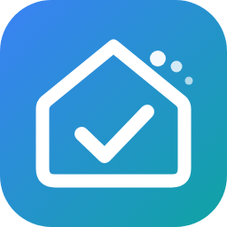

# Yuvomi für Home Assistant

*Inoffizielle Community-Integration – nicht Teil des Yuvomi-Projekts.* · [English](README.md)

Bindet den selbst gehosteten Familienplaner [Yuvomi](https://github.com/ulsklyc/yuvomi) an Home Assistant an. Yuvomi bleibt der Master: Was Home Assistant anlegt, ändert oder löscht, landet sofort in Yuvomi, und Änderungen in Yuvomi kommen in Home Assistant als Zustände und Ereignisse an.

Die Integration spricht **ausschließlich über die öffentliche REST-API (`/api/v1`)** mit einem API-Token und den unten genannten Scopes – die Schnittstelle, die der Yuvomi-Entwickler stabil zusagt. Jeder genutzte Endpunkt steht in Yuvomis OpenAPI-Spezifikation; interne Endpunkte, Datenbank oder Dateien werden nie angefasst. Fragen zu dieser Integration bitte hier im Repository stellen, nicht beim Yuvomi-Projekt.

## Voraussetzungen

- Yuvomi **ab 2.79**, **empfohlen ab 2.84**: Ab 2.84 meldet Yuvomi seine Schnittstellen-Generation (`client_api` in `/api/v1/version`). Die Integration prüft sie beim Einrichten und bei jedem Start. Ältere Versionen laufen, zeigen aber einen Hinweis unter Reparaturen.
- Home Assistant ab 2025.1.

## Installation

**HACS (benutzerdefiniertes Repository):** HACS → ⋮ → Benutzerdefinierte Repositories → `https://github.com/Thomas-1904/ha-yuvomi` hinzufügen (Typ *Integration*) → *Yuvomi (Community)* installieren → Home Assistant neu starten.

**Manuell:** `yuvomi.zip` aus dem neuesten [Release](https://github.com/Thomas-1904/ha-yuvomi/releases) laden, nach `/config/custom_components/yuvomi` entpacken, Home Assistant neu starten.

Danach: Einstellungen → Geräte & Dienste → Integration hinzufügen → **Yuvomi (Community)**, URL (z. B. `http://192.168.1.10:3005`) und API-Token eingeben, Module auswählen. Ändert sich das Token später, fragt Home Assistant nach dem neuen (erneute Anmeldung) – die Einrichtung bleibt erhalten.

## API-Token und Scopes

Token in Yuvomi unter *Einstellungen → API-Tokens* anlegen. Nur die Scopes für die gewünschten Module vergeben (`write` schließt `read` ein). Module ohne Berechtigung bleiben einfach leer.

| Modul der Integration | Scope | Hinweis |
|---|---|---|
| Immer (Mitglieder, Übersicht) | `family:read`, `dashboard:read` | |
| Aufgaben | `tasks:write` | `tasks:read` nur zum Anzeigen |
| Einkaufslisten | `shopping:write` | auch für den Bring-Abgleich |
| Familienkalender, Erinnerungen, Geburtstage | `calendar:write` | Yuvomi fasst alle drei unter `calendar` zusammen |
| Essensplan, Rezepte | `meals:write` | |
| Vorrat | `pantry:write` | |
| Inventar & Wartung | `inventory:write` | |
| Putzplan & Haushaltshilfe | `housekeeping:write` | |
| Müllabfuhr | `waste:read` | |
| Budget, Konten, Abos, Kredite, geteilte Ausgaben | `budget:write` | |
| Belohnungen & Taschengeld | `rewards:write` | |
| Notizen / Kontakte / Dokumente / Schichtplan / Gesundheit | `notes` / `contacts` / `documents` / `schedule` / `health` | `:read` oder `:write` |
| **Sofort-Aktualisierung (Kanal wird automatisch angelegt)** | Token eines **Administrators ohne Scopes** | Benachrichtigungskanäle sind Admin-Sache und nicht über Scopes abgedeckt; mit eingeschränktem Token die Option ausschalten und den Kanal von Hand anlegen (siehe unten) |

## Module und Entitäten

Mit echten Daten getestet: Aufgaben, Einkaufslisten, Vorrat, Familienkalender, Essensplan, Rezepte, Putzplan, Geburtstage, Erinnerungen. Inventar: Schnittstellen geprüft, bisher aber nur mit leerem Inventar.

**Experimentell** (nach der OpenAPI-Beschreibung gebaut, noch nicht mit echten Daten gelaufen – Rückmeldungen willkommen): Müllabfuhr, Budget/Konten/Abos, Kredite, geteilte Ausgaben, Belohnungen, Notizen, Kontakte, Dokumente, Schichtplan, Gesundheit. In der Modulauswahl als *(experimentell)* gekennzeichnet und standardmäßig aus.

| Modul | Entitäten |
|---|---|
| Aufgaben | To-do-Liste (anlegen, bearbeiten, abhaken mit „erledigt von“, Fälligkeit mit Uhrzeit, Beschreibung, Wiederholung; Mitglieder, Zuweisung, Priorität, Punkte als Attribute), Sensoren offen / überfällig / heute erledigt / diese Woche / 30 Tage / Serie / wiederkehrende Aufgaben, ein Sensor je Mitglied, Binärsensor überfällig |
| Einkaufslisten | Je Yuvomi-Liste eine To-do-Liste („Milch (2 l)“ setzt die Menge), Sensor offene Artikel |
| Familienkalender | Kalender (lesen, anlegen, löschen inkl. Serien), Sensor anstehende Termine |
| Essensplan | Kalender (Mahlzeitart in der Beschreibung), Sensor „Essen heute“ (Woche als Attribut) |
| Rezepte | Sensor mit allen Rezepten |
| Vorrat | To-do-Liste (Fälligkeit = MHD, abhaken = aufgebraucht), Sensoren Artikel / knapp / läuft ab, Binärsensor abgelaufen |
| Inventar & Wartung | Sensor Inventar, Sensor je Gegenstand mit nächster Wartung, Knopf „Erledigt“, Kalender „Fristen & Wartung“ |
| Putzplan & Haushaltshilfe | Sensor fällige Putzaufgaben (alle Aufgaben mit Bereich, Intervall, zuletzt erledigt, Status als Attribute), Knopf „Erledigt“ je Aufgabe, Binärsensor Haushaltshilfe da |
| Geburtstage | Kalender, Sensor nächster Geburtstag |
| Erinnerungen | Sensor fällige Erinnerungen, Binärsensor Erinnerung fällig |
| Müll *(exp.)* | Kalender, Sensoren nächste Abholung, Binärsensoren heute/morgen |
| Budget, Kredite, geteilte Ausgaben *(exp.)* | Ausgaben/Saldo Monat, Sensoren je Konto und Abo, Knopf „Abo verlängern“, Restschuld, Saldo geteilte Ausgaben |
| Belohnungen, Notizen, Kontakte, Dokumente, Schichten, Gesundheit *(exp.)* | Offene Einlösungen, angeheftete Notizen, Kontakte, ablaufende Dokumente, Kalender Schichtplan und Schichten heute, Medikamente, Vorsorge fällig, Gewicht, Blutdruck, Kalorien heute |
| Immer | Knopf „Neu laden“; Diagnosesensoren „Webhook“ (standardmäßig aus) und „Bring-Abgleich“ (wenn eingerichtet) |

„Erledigt von“: Wird eine Aufgabe in Home Assistant abgehakt, sucht die Integration das Yuvomi-Mitglied, dessen Name zum angemeldeten Home-Assistant-Benutzer passt (voller Name oder Vorname).

## Optionen

Einstellungen → Geräte & Dienste → Yuvomi → *Konfigurieren*:

- **Module**, die geladen werden (abgewählte Module entfernen ihre Entitäten).
- **Änderungsereignisse auslösen** (`yuvomi_changed`, standardmäßig an).
- **Abfrageintervall** in Sekunden (Standard 60, 15–3600).
- **Sofort-Aktualisierung**: Benachrichtigungskanal in Yuvomi automatisch anlegen (braucht ein Admin-Token ohne Scopes).
- **Bring-Liste** und **Yuvomi-Einkaufsliste** für den Bring-Abgleich (leer = aus).

## Aktuell halten

- **Abfrage** aller aktiven Module im eingestellten Intervall.
- **Änderungszähler:** Alle 15 s liest die Integration `/api/v1/shopping/versions` (eine sehr kleine Anfrage) und aktualisiert sofort, wenn sich eine Liste geändert hat.
- **Benachrichtigungskanal (empfohlen):** Yuvomi meldet seine Benachrichtigungen an einen Home-Assistant-Webhook; jede kommt als Ereignis `yuvomi_webhook` an und löst eine sofortige Aktualisierung aus. Kommen die Webhooks zuverlässig an, kann das Abfrageintervall großzügiger sein.
  - *Automatisch:* Die Option *Sofort-Aktualisierung* legt einen Kanal vom Typ *Webhook* namens „Home Assistant“ an.
  - *Von Hand* (z. B. mit eingeschränktem Token): Diagnosesensor „Webhook“ aktivieren – er zeigt den Pfad `/api/webhook/…`. In Yuvomi als Administrator einen Benachrichtigungskanal vom Typ *Webhook* mit der Adresse `<deine Home-Assistant-Adresse>` + diesem Pfad anlegen.
  - Yuvomi lehnt Adressen im Heimnetz ab, solange beim Yuvomi-Container nicht `NOTIFICATION_ALLOW_PRIVATE_NETWORK=true` gesetzt ist. Ohne diese Einstellung nimmt die Integration die externe Home-Assistant-Adresse (z. B. Nabu Casa), falls eine eingerichtet ist – die Benachrichtigungstexte laufen dann über diese externe Adresse.
  - Der Kanal transportiert *Benachrichtigungen* (Erinnerungen, fällige Aufgaben …), nicht jede Datenänderung. Die regelmäßige Abfrage bleibt die Absicherung.
- **Ratenlimit:** Yuvomi erlaubt 300 Anfragen pro Minute **je IP-Adresse**. Hinter NAT oder Reverse Proxy teilt sich Home Assistant dieses Kontingent womöglich mit den Handys der Familie. Die Integration begrenzt sich deshalb selbst auf 120 Anfragen pro Minute und pausiert automatisch, wenn Yuvomi mit `429` antwortet. Ein vollständiger Abruf aller Standardmodule braucht rund ein Dutzend Anfragen.

## Bring-Abgleich (optional)

In den Optionen lässt sich eine beliebige To-do-Liste aus Home Assistant (z. B. eine Bring-Liste aus der Bring-Integration) wählen, die in beide Richtungen mit einer Yuvomi-Einkaufsliste gleich gehalten wird: neue Artikel, abgehakt/wieder offen, gelöscht und Menge (Yuvomi-Menge ↔ Bring-Spezifikation). Abgeglichen wird über den Artikelnamen; ein gespeicherter Stand des letzten Abgleichs entscheidet, welche Seite sich geändert hat. Einträge, die nur unter Bring „Zuletzt verwendet“ stehen, werden nicht übernommen und bleiben dort, wenn Yuvomi Erledigte aufräumt. Der Abgleich läuft bei jeder Änderung auf einer der Seiten und alle 5 Minuten; `yuvomi.sync_bring` gleicht sofort ab, der Diagnosesensor „Bring-Abgleich“ zeigt das letzte Ergebnis.

## Dienste

- **Generisch** für jede Ressource der API: `yuvomi.create`, `yuvomi.get`, `yuvomi.update` (führt mit dem aktuellen Stand zusammen), `yuvomi.delete`. Unterobjekte brauchen eine `parent_id` (z. B. die Liste bei `shopping_item`).
- **Aufgaben & Haushalt:** `add_task`, `complete_task`, `complete_housekeeping`, `housekeeper_check`, `complete_inventory_date`, `dismiss_reminder`.
- **Einkauf & Essen:** `add_shopping_item`, `clear_checked`, `add_meal`, `meals_to_shopping`, `pantry_to_shopping`, `shopping_to_pantry`, `sync_bring`.
- **Experimentelle Module:** `add_budget_entry`, `renew_subscription`, `loan_payment`, `reward_bonus`, `redeem_reward`, `pin_note`, `check_note_item`, `add_vital`, `medication_dose`, `add_nutrition`.
- `yuvomi.refresh` erzwingt einen Abruf.
- `yuvomi.api_request` ruft beliebige `/api/v1/…`-Pfade direkt auf. **Das ist ein Notausgang:** Verbindlich ist nur, was in Yuvomis OpenAPI-Spezifikation steht – alles darüber hinaus kann mit jedem Yuvomi-Update brechen.

## Ereignisse

- `yuvomi_changed` bei jedem neuen, geänderten oder gelöschten Objekt: `resource`, `action` (`created`/`updated`/`deleted`), `id`, `title`, `item`, `changed`, `old_status`.
- `yuvomi_webhook` für eingehende Benachrichtigungen: `data.notification` mit `title`, `body`, `url`, `tag`, `priority`. Der Payload nennt keinen Empfänger – Benachrichtigungen an einzelne Handys zu verteilen, geht über eine eigene Automation (z. B. die Zuweisung der Aufgabe aus den Attributen der Aufgabenliste lesen).

## Fehlersuche

- **Ein Modul bleibt leer:** Dem Token fehlt der Scope des Moduls (siehe Tabelle) oder das Modul ist in Yuvomi nicht aktiv.
- **Einrichtung scheitert mit „fehlender Scope“:** Das Token braucht mindestens `family:read`.
- **Reparatur-Hinweis „Update empfohlen“ / „zu alt“:** Yuvomi aktualisieren; der Hinweis verschwindet beim nächsten Start.
- **Keine Sofort-Aktualisierung:** Im Log nach „Yuvomi-Push nicht eingerichtet“ suchen (Kanal konnte nicht angelegt werden – Token ohne Admin-Rechte oder keine erreichbare Adresse) und den Kanalstatus in Yuvomi prüfen.
- **Meldungen zum Ratenlimit:** Abfrageintervall erhöhen; andere Geräte hinter derselben IP zählen bei Yuvomi mit.

## Entfernen

Integration unter Einstellungen → Geräte & Dienste löschen, danach in HACS entfernen (oder `custom_components/yuvomi` löschen). Ein von der Integration angelegter Benachrichtigungskanal bleibt in Yuvomi und kann dort gelöscht werden.

## Bekannte Grenzen

- Getestet mit einem Haushalt und einer Yuvomi-Instanz (Yuvomi 2.79 und 2.84, Docker). Mehrere Yuvomi-Instanzen in einem Home Assistant sollten funktionieren, sind aber nicht getestet.
- Einige Log- und Fehlermeldungen gibt es bisher nur auf Deutsch.

## Lizenz

MIT – siehe [LICENSE](LICENSE). Yuvomi selbst ist ein eigenständiges Projekt mit eigener Lizenz. Das Icon ist ein eigener Entwurf für diese Integration.
