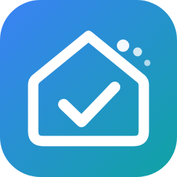

# Yuvomi for Home Assistant

*Unofficial community integration – not affiliated with the Yuvomi project.* · [Deutsch](README.de.md)

Connects the self-hosted family planner [Yuvomi](https://github.com/ulsklyc/yuvomi) to Home Assistant. Yuvomi stays the source of truth: everything Home Assistant creates, changes or deletes is written to Yuvomi immediately, and changes made in Yuvomi show up in Home Assistant as entity states and events.

The integration talks to Yuvomi **only through the public REST API (`/api/v1`)** with an API token and the scopes listed below – the interface the Yuvomi maintainer commits to keeping stable. Every endpoint it uses is part of Yuvomi's OpenAPI specification; internal endpoints, the database or files are never touched. Questions about this integration go to this repository, not to the Yuvomi project.

## Requirements

- Yuvomi **2.79 or newer**, **2.84+ recommended**: from 2.84 Yuvomi reports its API generation (`client_api` in `/api/v1/version`), which the integration checks during setup and on every start. Older versions work but show a repair notice.
- Home Assistant 2025.1 or newer.

## Installation

**HACS (custom repository):** HACS → ⋮ → Custom repositories → add `https://github.com/Thomas-1904/ha-yuvomi` (type *Integration*) → install *Yuvomi (Community)* → restart Home Assistant.

**Manual:** download `yuvomi.zip` from the latest [release](https://github.com/Thomas-1904/ha-yuvomi/releases), unpack it to `/config/custom_components/yuvomi`, restart Home Assistant.

Then: Settings → Devices & services → Add integration → **Yuvomi (Community)**, enter the URL (e.g. `http://192.168.1.10:3005`) and an API token, and pick the modules you want. If the token changes later, Home Assistant asks for the new one (re-authentication) – the configuration is kept.

## API token and scopes

Create the token in Yuvomi under *Settings → API tokens*. Give it only the scopes for the modules you enable (`write` includes `read`). Modules without permission simply stay empty.

| Integration module | Scope | Notes |
|---|---|---|
| Always (members, overview) | `family:read`, `dashboard:read` | |
| Tasks | `tasks:write` | `tasks:read` for display only |
| Shopping lists | `shopping:write` | also needed for the Bring sync |
| Family calendar, Reminders, Birthdays | `calendar:write` | Yuvomi groups these three under `calendar` |
| Meal plan, Recipes | `meals:write` | |
| Pantry | `pantry:write` | |
| Inventory & maintenance | `inventory:write` | |
| Cleaning plan & housekeeper | `housekeeping:write` | |
| Waste collection | `waste:read` | |
| Budget, accounts, subscriptions, loans, shared expenses | `budget:write` | |
| Rewards & pocket money | `rewards:write` | |
| Notes / Contacts / Documents / Shift schedule / Health | `notes` / `contacts` / `documents` / `schedule` / `health` | `:read` or `:write` |
| **Instant updates (notification channel created automatically)** | unscoped token of an **administrator** | notification channels are admin-only and not covered by scopes; with a scoped token, turn the option off and create the channel by hand (see below) |

## Modules and entities

Tested against real data: tasks, shopping lists, pantry, family calendar, meal plan, recipes, cleaning plan, birthdays, reminders. Inventory: endpoints verified, but only with an empty inventory so far.

**Experimental** (built from the OpenAPI specification, not yet run against real data – feedback welcome): waste collection, budget/accounts/subscriptions, loans, shared expenses, rewards, notes, contacts, documents, shift schedule, health. They are marked *(experimental)* in the module list and are off by default.

| Module | Entities |
|---|---|
| Tasks | To-do list (create, edit, complete with "done by", due date/time, description, recurrence; members, assignment, priority, points as attributes), sensors open / overdue / done today / done this week / done 30 days / completion streak / recurring tasks, one sensor per member, overdue binary sensor |
| Shopping lists | One to-do list per Yuvomi list (`Milk (2 l)` sets the quantity), open-items sensor |
| Family calendar | Calendar (read, create, delete incl. series), upcoming-events sensor |
| Meal plan | Calendar (meal type in the description), "meal today" sensor (week as attribute) |
| Recipes | Sensor with all recipes |
| Pantry | To-do list (due = best-before, completing = used up), sensors items / low / expiring, expired binary sensor |
| Inventory & maintenance | Inventory sensor, sensor per item with next service, "done" button, deadlines calendar |
| Cleaning plan & housekeeper | Due-chores sensor (all chores with area, interval, last done, status as attributes), "done" button per chore, housekeeper-present binary sensor |
| Birthdays | Birthdays calendar, next-birthday sensor |
| Reminders | Pending-reminders sensor, reminder-due binary sensor |
| Waste *(exp.)* | Calendar, next-collection sensors, today/tomorrow binary sensors |
| Budget, loans, shared expenses *(exp.)* | Expenses/balance this month, per-account and subscription sensors, renew button, remaining loans, shared balance |
| Rewards, notes, contacts, documents, shifts, health *(exp.)* | Pending redemptions, pinned notes, contacts, expiring documents, shift-plan calendar and shifts today, medications, prevention due, weight, blood pressure, calories today |
| Always | Refresh button; diagnostic sensors "Webhook" (disabled by default) and "Bring sync" (when configured) |

"Done by": when a task is completed from Home Assistant, the integration looks for the Yuvomi member whose name matches the logged-in Home Assistant user (full or first name).

## Options

Settings → Devices & services → Yuvomi → *Configure*:

- **Modules** to load (deselected modules remove their entities).
- **Fire change events** (`yuvomi_changed`, on by default).
- **Polling interval** in seconds (default 60, 15–3600).
- **Instant updates**: create the Yuvomi notification channel automatically (needs an admin token without scopes).
- **Bring list** and **Yuvomi shopping list** for the Bring sync (empty = off).

## Keeping Home Assistant up to date

- **Polling** of all enabled modules at the configured interval.
- **Change counters**: every 15 s the integration reads `/api/v1/shopping/versions` (one tiny request) and refreshes immediately when a list changed.
- **Notification channel (recommended):** Yuvomi forwards its notifications to a Home Assistant webhook; each one arrives as the event `yuvomi_webhook` and triggers an immediate refresh. With working webhooks you can set the polling interval more generously.
  - *Automatic:* the option *Instant updates* creates a channel of type *webhook* named "Home Assistant".
  - *By hand* (e.g. with a scoped token): enable the diagnostic sensor "Webhook" – it shows the path `/api/webhook/…`. In Yuvomi, as an administrator, add a notification channel of type *Webhook* with the URL `<your Home Assistant URL>` + that path.
  - Yuvomi refuses channel URLs in private networks unless `NOTIFICATION_ALLOW_PRIVATE_NETWORK=true` is set for the Yuvomi container. Without it the integration uses Home Assistant's external URL (e.g. Nabu Casa) if one is configured – notification texts then travel via that external address.
  - The channel carries *notifications* (reminders, due tasks …), not every data change. Polling remains the backstop.
- **Rate limit:** Yuvomi allows 300 requests per minute **per IP address**. Behind NAT or a reverse proxy Home Assistant may share this budget with the family's phones. The integration therefore throttles itself to 120 requests per minute and pauses automatically when Yuvomi answers `429`. A full refresh of all default modules needs about a dozen requests.

## Bring sync (optional)

In the options you can pick any Home Assistant to-do list (e.g. a Bring list from the Bring integration) to keep in sync with a Yuvomi shopping list in both directions: new items, checked/unchecked, deleted items and quantity (Yuvomi quantity ↔ Bring specification). Items are matched by name; a stored snapshot of the last sync decides which side changed. Items that are only in Bring's "recently used" list are not imported, and stay there when Yuvomi clears checked items. It runs on every change on either side and every 5 minutes; `yuvomi.sync_bring` runs it immediately, and the diagnostic sensor "Bring sync" shows the last result.

## Services

- **Generic** for every resource of the API: `yuvomi.create`, `yuvomi.get`, `yuvomi.update` (merges with the current record), `yuvomi.delete`. Sub-objects take a `parent_id` (e.g. the list for `shopping_item`).
- **Tasks & household:** `add_task`, `complete_task`, `complete_housekeeping`, `housekeeper_check`, `complete_inventory_date`, `dismiss_reminder`.
- **Shopping & food:** `add_shopping_item`, `clear_checked`, `add_meal`, `meals_to_shopping`, `pantry_to_shopping`, `shopping_to_pantry`, `sync_bring`.
- **Experimental modules:** `add_budget_entry`, `renew_subscription`, `loan_payment`, `reward_bonus`, `redeem_reward`, `pin_note`, `check_note_item`, `add_vital`, `medication_dose`, `add_nutrition`.
- `yuvomi.refresh` forces a refresh.
- `yuvomi.api_request` calls any `/api/v1/…` path directly. **This is an escape hatch:** only what is part of Yuvomi's OpenAPI specification is a supported contract – anything beyond it may break with any Yuvomi update.

## Events

- `yuvomi_changed` for every created, updated or deleted object: `resource`, `action` (`created`/`updated`/`deleted`), `id`, `title`, `item`, `changed`, `old_status`.
- `yuvomi_webhook` for incoming notifications: `data.notification` with `title`, `body`, `url`, `tag`, `priority`. The payload names no recipient – to send notifications to individual phones, use your own automation (e.g. look up the task's assignee from the tasks to-do list's attributes).

## Troubleshooting

- **A module stays empty:** the token lacks that module's scope (see table) or the module is not active in Yuvomi.
- **Setup fails with "missing scope":** the token needs at least `family:read`.
- **Repair notice "Yuvomi update recommended" / "too old":** update Yuvomi; the notice disappears on the next start.
- **No instant updates:** check the log for "Yuvomi-Push nicht eingerichtet" (channel could not be created – token without admin rights, or no reachable URL) and Yuvomi's channel status.
- **Rate limit messages:** raise the polling interval; other devices behind the same IP count towards Yuvomi's limit too.

## Removal

Delete the integration under Settings → Devices & services, then remove it in HACS (or delete `custom_components/yuvomi`). A notification channel created by the integration stays in Yuvomi and can be deleted there.

## Known limitations

- Tested with one household and one Yuvomi instance (Yuvomi 2.79 and 2.84, Docker). Several Yuvomi instances in one Home Assistant should work but are untested.
- Some log and error messages are still German only.

## License

MIT – see [LICENSE](LICENSE). Yuvomi itself is a separate project with its own license. The icon is an original design for this integration.
